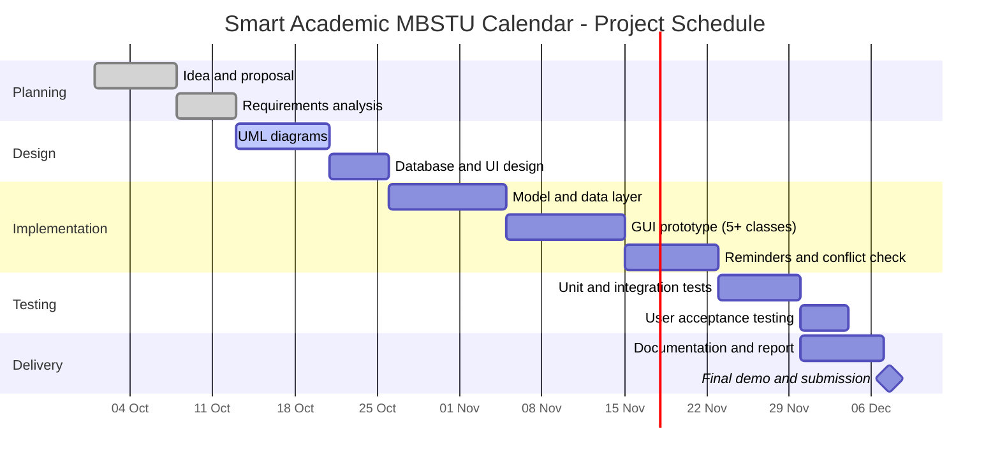
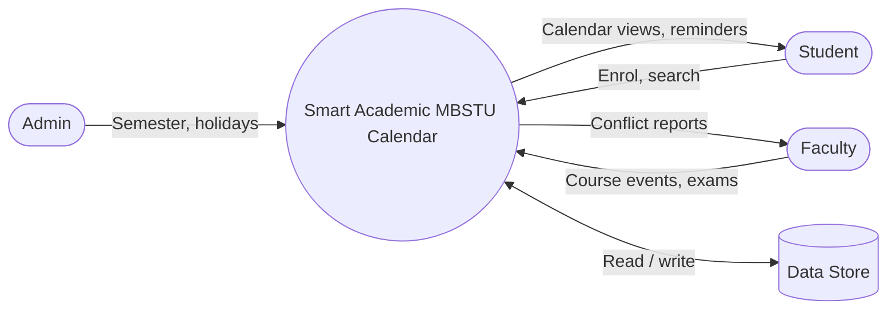
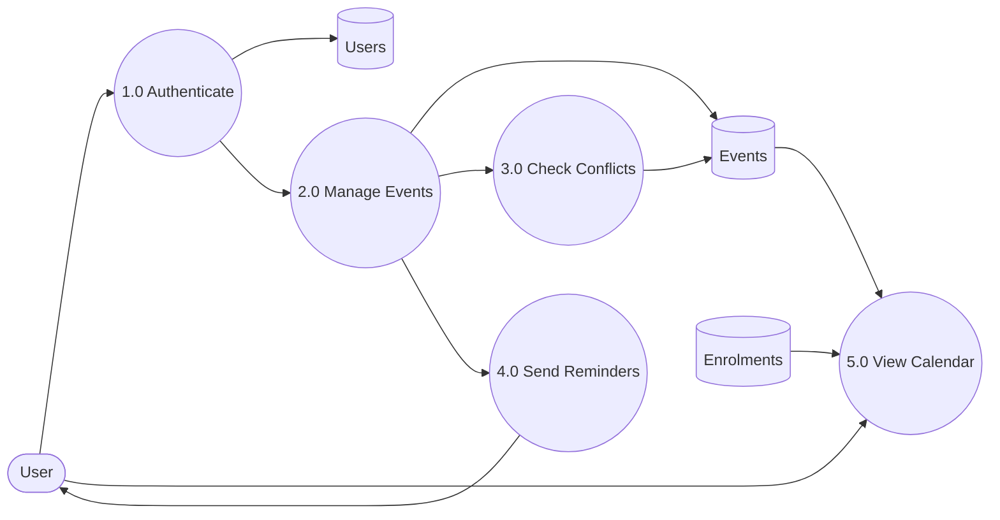
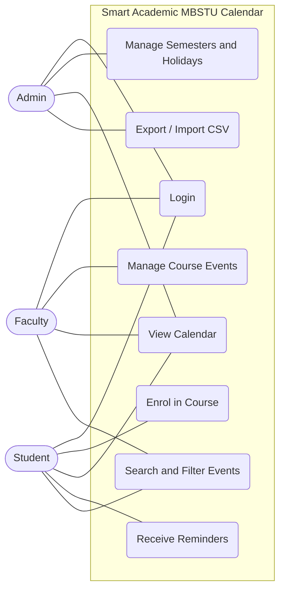
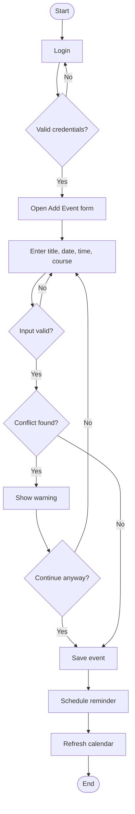
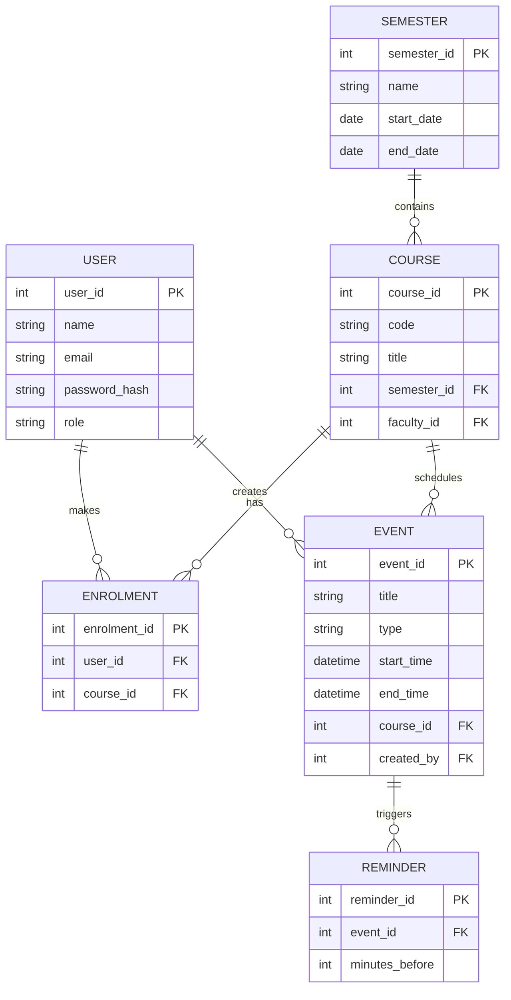
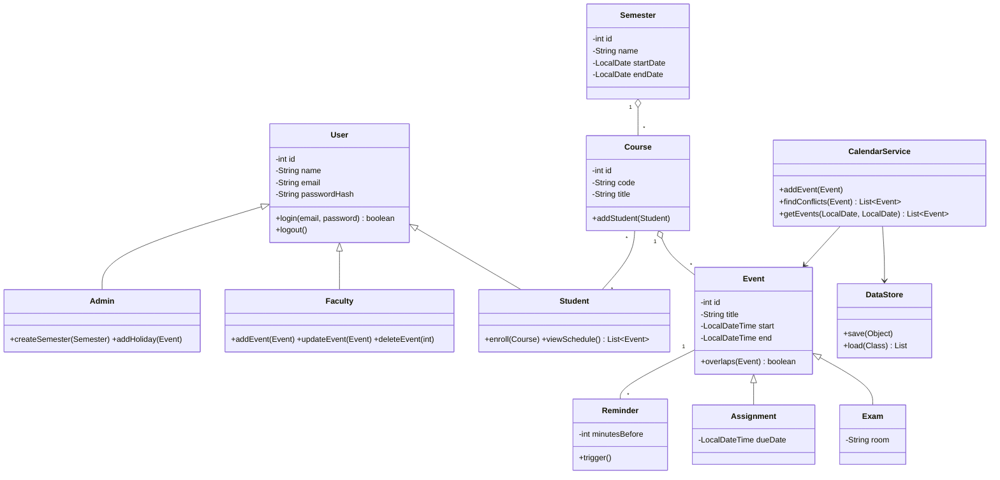
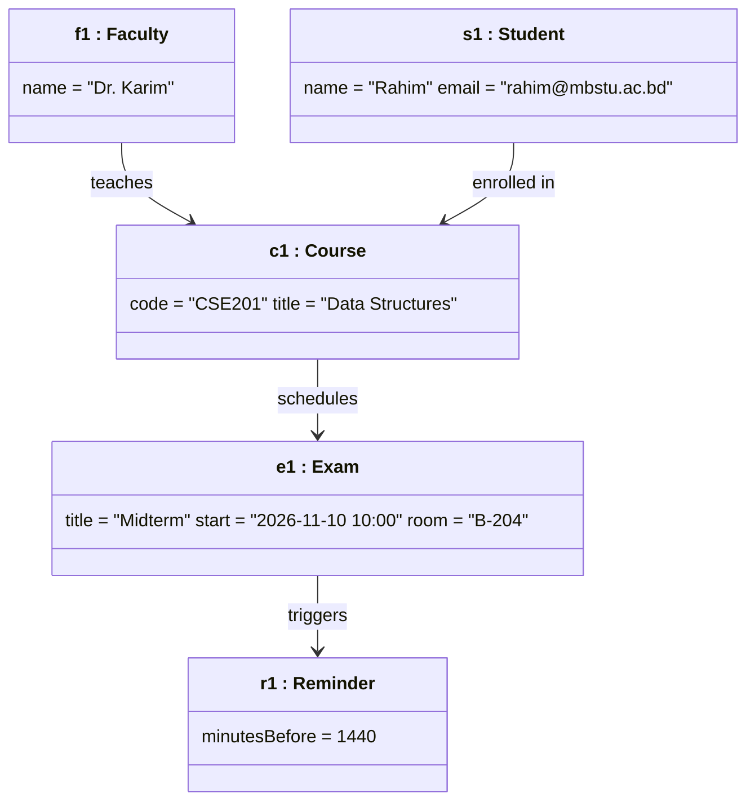

# Smart Academic MBSTU Calendar

> **Capstone Project – Part I: Proposal and Prototyping**
> **Student:** Dipu Mondol | **ID:** IT24040 | **University:** Mawlana Bhashani Science and Technology University (MBSTU)

**Smart Academic MBSTU Calendar** is a desktop application written in **Java** that helps MBSTU students, faculty and administrators plan the academic year: semesters, class schedules, exams, assignment deadlines, holidays and reminders, all in one calendar.

---

## Table of Contents
1. [Project Idea and Problem Statement](#1-project-idea-and-problem-statement)
2. [Objectives and Scope](#2-objectives-and-scope)
3. [Requirements](#3-requirements)
4. [Software Process Model](#4-software-process-model)
5. [Schedule, Milestones and Deliverables](#5-schedule-milestones-and-deliverables)
6. [Risk Analysis](#6-risk-analysis)
7. [UML and Design Diagrams](#7-uml-and-design-diagrams)
8. [Prototype (Simple Interface)](#8-prototype-simple-interface)
9. [Repository Structure](#9-repository-structure)
10. [How to Build and Run](#10-how-to-build-and-run)
11. [Testing Plan](#11-testing-plan)
12. [Future Work](#12-future-work)
13. [References](#13-references)

---

## 1. Project Idea and Problem Statement

Students at MBSTU often track semester dates, exam schedules, holidays and assignment deadlines across notice boards, PDFs and chat groups. Important dates get missed and schedules conflict.

**Smart Academic MBSTU Calendar** provides one place where:
- An **Admin** publishes the official academic calendar (semesters, holidays, exam weeks).
- **Faculty** add class sessions, assignments and exams for their courses.
- **Students** see a personalised calendar for the courses they are enrolled in and receive reminders before deadlines.

## 2. Objectives and Scope

**Objectives**
- Build a user-friendly Java desktop application for managing academic events.
- Detect schedule conflicts automatically (for example two exams at the same time).
- Provide reminders and a search and filter function.
- Store data persistently (files or database in `data/`, settings in `config/`).

**In scope:** login and roles, semester and course management, event CRUD, enrolment, reminders, conflict detection, calendar (month, week and list) views, import and export (CSV).

**Out of scope (first version):** mobile app, cloud sync, online payments, integration with an external LMS.

## 3. Requirements

### 3.1 Functional Requirements
| ID | Requirement |
|----|-------------|
| FR1 | Users can register and log in; roles are Admin, Faculty and Student. |
| FR2 | Admin can create, update and delete semesters and holidays. |
| FR3 | Faculty can create, update and delete course events (class, assignment, exam). |
| FR4 | Students can enrol in or drop courses. |
| FR5 | The system shows a monthly, weekly and list view of events. |
| FR6 | The system warns about conflicting events. |
| FR7 | The system sends reminders before deadlines. |
| FR8 | Users can search and filter events by course, type or date. |
| FR9 | Calendar data can be exported to and imported from CSV. |

### 3.2 Non-Functional Requirements
- **Usability:** a new user can add an event in under one minute.
- **Performance:** calendar view loads in under 2 seconds for 1,000 events.
- **Reliability:** data is saved after every change; no data loss on a normal exit.
- **Security:** passwords are stored hashed, never as plain text.
- **Portability:** runs on any OS with JDK 17 or later.
- **Maintainability:** layered architecture (UI, service, data) and JavaDoc comments.

### 3.3 Technology Stack
Java 17+, Swing (or JavaFX) for the GUI, JDBC with SQLite (or file storage), JUnit 5 for tests, Maven or Gradle for the build, Git and GitHub for version control, LaTeX for the report.

## 4. Software Process Model

**Chosen model: Agile (Scrum-style iterative and incremental development).**

*Why:* requirements (views, reminders, roles) are expected to evolve with feedback; each sprint produces a working increment; risks are found early; it suits a small team (one student) with a fixed deadline.

| Sprint | Focus | Output |
|--------|-------|--------|
| Sprint 0 | Planning and requirements | Proposal, backlog |
| Sprint 1 | Design | UML diagrams, DB schema |
| Sprint 2 | Core classes and data layer | Model classes, DAO |
| Sprint 3 | GUI prototype | Login and calendar screens |
| Sprint 4 | Features | Reminders, conflict check |
| Sprint 5 | Testing and polish | Test report, final demo |

## 5. Schedule, Milestones and Deliverables

### 5.1 Gantt Chart
> Adjust the dates to your real semester. GitHub renders this chart automatically.



### 5.2 Milestones
| # | Milestone | Target |
|---|-----------|--------|
| M1 | Proposal approved | End of Week 1 |
| M2 | Requirements and UML complete | End of Week 3 |
| M3 | Working GUI prototype | End of Week 6 |
| M4 | All features implemented | End of Week 8 |
| M5 | Testing complete, final submission | End of Week 10 |

### 5.3 Deliverables
| Deliverable | Description |
|-------------|-------------|
| D1 | Project proposal (this README and LaTeX report) |
| D2 | Gantt chart and schedule |
| D3 | UML diagrams (DFD, Use Case, Activity, ERD, Class, Object) |
| D4 | Prototype source code in `src/` |
| D5 | Test plan and results |
| D6 | User manual and final report |

## 6. Risk Analysis
| Risk | Probability | Impact | Mitigation |
|------|-------------|--------|------------|
| Underestimated schedule | Medium | High | Sprint reviews and buffer time |
| GUI complexity | Medium | Medium | Start with simple Swing layouts |
| Data loss or corruption | Low | High | Regular backups, transactions |
| Scope creep | High | Medium | Fixed backlog, "future work" list |

## 7. UML and Design Diagrams

### 7.1 Data Flow Diagram (Level 0, context)


### 7.2 Data Flow Diagram (Level 1)


### 7.3 Use Case Diagram


### 7.4 Activity Diagram (Add an Event)


### 7.5 Entity Relationship Diagram


### 7.6 Class Diagram


### 7.7 Object Diagram


## 8. Prototype (Simple Interface)

The prototype is a Java Swing GUI that uses **at least 5 classes from the class diagram**:

| Class used | Role in the prototype |
|------------|-----------------------|
| `User` / `Student` | Login screen and role-based menu |
| `Course` | Course list and enrolment panel |
| `Event` (`Exam`, `Assignment`) | Add / edit event form and table |
| `Reminder` | Reminder setting on the event form |
| `CalendarService` | Month view and conflict warning |
| `DataStore` | Saves and loads data from `data/` |

**Planned screens:** Login → Dashboard (month calendar) → Add / Edit Event → Course List → Settings.

*(Add screenshots here: `docs/screenshots/login.png`, `docs/screenshots/calendar.png`)*

## 9. Repository Structure
```
java-academic-calender/
├── config/        # Application settings (e.g. app.properties)
├── data/          # Stored data (database file / CSV)
├── src/           # Java source code
│   ├── model/     # User, Student, Faculty, Admin, Course, Event, Exam, Assignment, Reminder, Semester
│   ├── service/   # CalendarService, ReminderService, AuthService
│   ├── data/      # DataStore, DAO classes
│   └── ui/        # Swing frames and panels, Main.java
├── docs/          # Diagrams, screenshots, LaTeX report
└── README.md
```

## 10. How to Build and Run
```bash
# Requirements: JDK 17+
git clone https://github.com/Dipu22222/java-academic-calender.git
cd java-academic-calender

# compile
mkdir -p out
javac -d out $(find src -name "*.java")

# run (replace with your main class)
java -cp out ui.Main
```

## 11. Testing Plan
| Type | Tool | What is tested |
|------|------|----------------|
| Unit | JUnit 5 | `Event.overlaps()`, `CalendarService.findConflicts()` |
| Integration | JUnit 5 | Data layer reads and writes |
| UI / manual | Test cases | Login, add event, enrol, reminders |
| Acceptance | Peer users | Usability against the requirements |

## 12. Future Work
Cloud sync, mobile companion app, email and push notifications, Google Calendar and iCal export, and a dark mode theme.

## 13. References
- I. Sommerville, *Software Engineering*, Pearson.
- R. Pressman, *Software Engineering: A Practitioner's Approach*, McGraw-Hill.
- Oracle, *Java Platform Documentation*: https://docs.oracle.com/en/java/
- OMG, *Unified Modeling Language Specification*.

---
*Course project submitted for academic purposes.*
